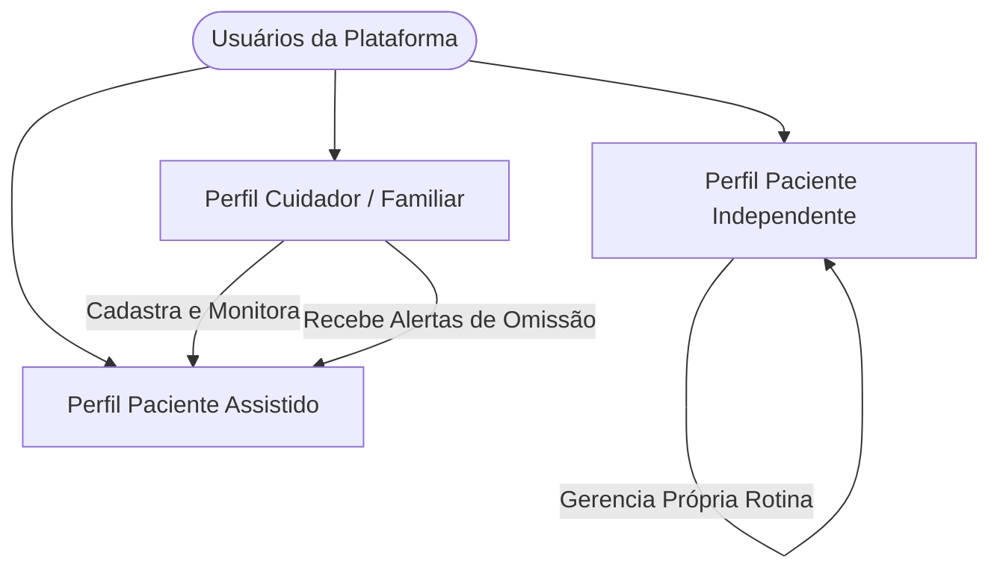

# 👥 03. Perfis de Usuário, Personas e Histórias de Usuário

## 1. Perfis de Usuário (Atores)

---

## 2. Personas

### Persona 1: Sr. Sebastião (Paciente Assistido)
- **Idade:** 74 anos, aposentado.
- **Contexto:** Possui hipertensão e diabetes leve. Toma 4 remédios diferentes em horários variados do dia. Possui baixa visão e tremores leves nas mãos.
- **Dores:** Tem dificuldade em ler letrinhas de caixas de remédio, esquece se já tomou a dose da manhã e tem medo de tomar dose dupla.
- **Necessidade no App:** Tela limpa, aviso sonoro alto, imagem do remédio grande e um botão verde bem destacado para confirmar.

### Persona 2: Juliana (Cuidadora / Filha)
- **Idade:** 42 anos, advogada.
- **Contexto:** Filha do Sr. Sebastião. Trabalha fora o dia todo e divide os cuidados do pai com o irmão Carlos.
- **Dores:** Vive ansiosa sem saber se o pai tomou os remédios no horário correto. Freqüentemente descobre de última hora que o remédio da pressão acabou na farmácia.
- **Necessidade no App:** Notificação no celular se o pai atrasar mais de 30 minutos para tomar a medicação, controle compartilhado de estoque com o irmão e alerta preventivo 5 dias antes do remédio acabar.

### Persona 3: Lucas (Paciente Independente)
- **Idade:** 28 anos, engenheiro de software.
- **Contexto:** Faz tratamento para rinite alérgica e suplementação vitamínica diária.
- **Dores:** Correria do trabalho faz esquecer as doses do meio do dia e o reabastecimento mensal.
- **Necessidade no App:** App prático para programar sua rotina, registro rápido de dose e lembrete automático de compra.

### Persona 4: Carla (Mãe / Cuidadora de Tratamento Pediátrico)
- **Idade:** 34 anos, enfermeira.
- **Contexto:** Seu filho Enzo (5 anos) está com amigdalite bacteriana e precisa tomar Amoxicilina a cada 8 horas por 10 dias seguidos.
- **Dores:** Dificuldade em acordar de madrugada para dar o remédio na hora exata, medo de errar a quantidade de ml da seringa e risco de interromper o antibiótico antes do 10º dia quando a febre passa.
- **Necessidade no App:** Alarme pontual (inclusive noturno), indicação clara de dosagem líquida em ml e contagem regressiva visível ("Dia 4 de 10").

### Persona 5: Roberto (Paciente Pós-Cirúrgico)
- **Idade:** 50 anos, comerciante.
- **Contexto:** Realizou cirurgia no joelho e recebeu prescrição de analgésico de resgate por 5 dias e injeções de anticoagulante por 14 dias.
- **Dores:** Dificuldade de locomoção e confusão com múltiplos remédios com datas de término diferentes.
- **Necessidade no App:** Calendário que encerre e arquive cada medicamento automaticamente no fim do ciclo estipulado pelo cirurgião.

---

## 3. Histórias de Usuário (User Stories)

### Épico 1: Gestão de Prescrições e Medicamentos
- **US01:** *Como cuidador*, quero cadastrar um medicamento com nome, formato e dosagem, para que meu familiar saiba exatamente qual remédio ingerir.
- **US02:** *Como cuidador*, quero definir a frequência (ex: a cada 8h) e horários de início, para que o sistema gere automaticamente a agenda de alarmes.

### Épico 2: Alarmes e Confirmação de Doses
- **US03:** *Como paciente assistido*, quero receber um alerta sonoro e visual em tela cheia com a foto e o nome do remédio, para que eu identifique a medicação facilmente.
- **US04:** *Como paciente assistido*, quero confirmar com apenas um toque no botão "JÁ TOMEI", para registrar o cumprimento da dose sem complicações.
- **US05:** *Como paciente*, quero poder solicitar "Adiar 10 minutos" caso não possa tomar no momento exato do alarme.
- **US12:** *Como paciente*, quando tiver múltiplos remédios no mesmo horário, quero ver uma "Bandeja / Checklist Visual" com todos os remédios juntos ou um modo passo a passo com leitura de voz, para não me confundir nem esquecer nenhum deles.
- **US13:** *Como paciente*, quero poder confirmar todos os remédios do horário de uma só vez ("Tomei Todos") ou marcar individualmente caso algum falte.

### Épico 3: Controle e Alertas de Estoque
- **US06:** *Como cuidador*, quero cadastrar a quantidade total de comprimidos comprados e os dias de segurança, para que o aplicativo gerencie o saldo automaticamente.
- **US07:** *Como cuidador*, quero receber um alerta avisando quando restarem poucos dias de tratamento, para que eu possa comprar nova caixa com antecedência.
- **US08:** *Como cuidador*, quero que o sistema abata automaticamente cada dose tomada do saldo físico de estoque.

### Épico 4: Monitoramento e Vínculo Familiar
- **US09:** *Como cuidador*, quero receber um aviso urgente caso meu familiar assistido atrase o remédio além do limite de tolerância, para que eu possa ligar para ele.
- **US10:** *Como cuidador*, quero poder compartilhar o acesso do paciente com outro familiar, para que ambos recebam os alertas e colaborem nas compras.

### Épico 5: Relatórios e Acompanhamento Clínico
- **US11:** *Como cuidador ou paciente*, quero visualizar um gráfico de adesão percentual semanal/mensal, para apresentar ao médico na consulta de rotina.

### Épico 6: Tratamentos Temporários, Pediátricos e Pós-Operatórios
- **US14:** *Como mãe/pai cuidador*, quero cadastrar um antibiótico com dosagem líquida em ml e duração de 7 a 10 dias, para acompanhar o tratamento do meu filho até o fim.
- **US15:** *Como paciente pós-cirúrgico ou cuidador*, quero ver um indicador de "Dia X de Y" com barra de progresso para saber exatamente quantos dias faltam para concluir o ciclo.
- **US16:** *Como usuário*, quero que o sistema encerre os alarmes e arquive a prescrição automaticamente quando o ciclo terminar, mantendo o histórico intacto.
