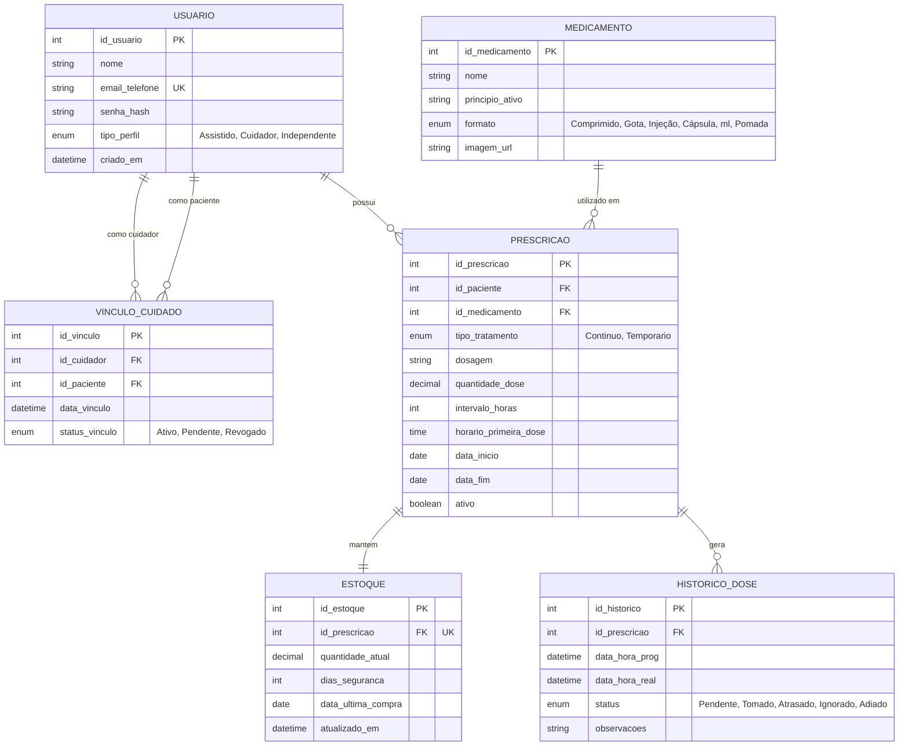

# 🗄️ 04. Modelo de Dados e Banco de Dados (DER / MER)

## 1. Diagrama Entidade-Relacionamento (DER)



---

## 2. Dicionário de Dados

### 2.1. Tabela `usuario`
Armazena as credenciais, perfis e dados de acesso.
| Coluna | Tipo | Nulo | Restrição | Descrição |
|---|---|---|---|---|
| `id_usuario` | INT / SERIAL | NÃO | PK | Identificador único do usuário |
| `nome` | VARCHAR(100) | NÃO | - | Nome completo |
| `email_telefone` | VARCHAR(100) | NÃO | UNIQUE | Login único (e-mail ou celular) |
| `senha_hash` | VARCHAR(255) | NÃO | - | Hash criptografado (Argon2 / bcrypt) |
| `tipo_perfil` | ENUM | NÃO | - | `Assistido`, `Cuidador`, `Independente` |
| `criado_em` | TIMESTAMP | NÃO | DEFAULT NOW() | Data de cadastro |

### 2.2. Tabela `vinculo_cuidado`
Resolve a cardinalidade $N:N$ entre Cuidadores e Pacientes Assistidos.
| Coluna | Tipo | Nulo | Restrição | Descrição |
|---|---|---|---|---|
| `id_vinculo` | INT / SERIAL | NÃO | PK | Identificador único do vínculo |
| `id_cuidador` | INT | NÃO | FK (`usuario.id_usuario`) | Referência ao usuário cuidador |
| `id_paciente` | INT | NÃO | FK (`usuario.id_usuario`) | Referência ao paciente assistido |
| `data_vinculo` | TIMESTAMP | NÃO | DEFAULT NOW() | Data em que o vínculo foi estabelecido |
| `status_vinculo` | ENUM | NÃO | DEFAULT 'Ativo' | `Ativo`, `Pendente`, `Revogado` |

### 2.3. Tabela `medicamento`
Catálogo de substâncias e apresentações farmacêuticas.
| Coluna | Tipo | Nulo | Restrição | Descrição |
|---|---|---|---|---|
| `id_medicamento` | INT / SERIAL | NÃO | PK | Identificador do medicamento |
| `nome` | VARCHAR(100) | NÃO | - | Nome comercial (ex.: Losartana Potássica) |
| `principio_ativo` | VARCHAR(100) | SIM | - | Princípio ativo (ex.: Losartana) |
| `formato` | ENUM | NÃO | - | `Comprimido`, `Gota`, `Injeção`, `Cápsula`, `ml`, `Pomada` |
| `imagem_url` | VARCHAR(255) | SIM | - | URL da foto/ícone da caixa ou comprimido |

### 2.4. Tabela `prescricao`
Regras de frequência, dosagem e horário do tratamento.
| Coluna | Tipo | Nulo | Restrição | Descrição |
|---|---|---|---|---|
| `id_prescricao` | INT / SERIAL | NÃO | PK | Identificador único da prescrição |
| `id_paciente` | INT | NÃO | FK (`usuario.id_usuario`) | Paciente em tratamento |
| `id_medicamento` | INT | NÃO | FK (`medicamento.id_medicamento`) | Medicamento prescrito |
| `tipo_tratamento` | ENUM | NÃO | DEFAULT 'Continuo' | `Continuo` (crônico/longo prazo) ou `Temporario` (antibióticos, pós-cirúrgico) |
| `dosagem` | VARCHAR(50) | NÃO | - | Ex.: "50mg", "20 gotas", "5ml" |
| `quantidade_dose` | DECIMAL(5,2) | NÃO | - | Quantidade física deduzida por dose (ex.: 1.0, 1.5, 5.0) |
| `intervalo_horas` | INT | NÃO | - | Intervalo entre doses (ex.: 8h, 12h, 24h) |
| `horario_primeira_dose` | TIME | NÃO | - | Horário âncora inicial (ex.: 08:00:00) |
| `data_inicio` | DATE | NÃO | - | Data de início do tratamento |
| `data_fim` | DATE | SIM | - | Data de término (obrigatória para Temporário, NULL para Contínuo) |
| `ativo` | BOOLEAN | NÃO | DEFAULT TRUE | Se o tratamento está em vigor |

### 2.5. Tabela `estoque`
Controle de saldo físico e dias de cobertura.
| Coluna | Tipo | Nulo | Restrição | Descrição |
|---|---|---|---|---|
| `id_estoque` | INT / SERIAL | NÃO | PK | Identificador do estoque |
| `id_prescricao` | INT | NÃO | FK (`prescricao.id_prescricao`), UNIQUE | Prescrição vinculada |
| `quantidade_atual` | DECIMAL(8,2) | NÃO | - | Saldo de unidades disponíveis |
| `dias_seguranca` | INT | NÃO | DEFAULT 5 | Margem para disparar alerta de compra |
| `data_ultima_compra` | DATE | SIM | - | Data da última recarga |
| `atualizado_em` | TIMESTAMP | NÃO | DEFAULT NOW() | Timestamp da última alteração |

### 2.6. Tabela `historico_dose`
Registro individual de cada alarme e status de adesão.
| Coluna | Tipo | Nulo | Restrição | Descrição |
|---|---|---|---|---|
| `id_historico` | INT / SERIAL | NÃO | PK | Identificador do registro |
| `id_prescricao` | INT | NÃO | FK (`prescricao.id_prescricao`) | Prescrição relacionada |
| `data_hora_prog` | TIMESTAMP | NÃO | - | Horário programado para o alarme |
| `data_hora_real` | TIMESTAMP | SIM | - | Horário exato da confirmação |
| `status` | ENUM | NÃO | DEFAULT 'Pendente' | `Pendente`, `Tomado`, `Atrasado`, `Ignorado`, `Adiado` |
| `observacoes` | TEXT | SIM | - | Notas adicionais |

---

## 3. Script SQL DDL (PostgreSQL)

```sql
-- Criação de Tipos ENUM
CREATE TYPE tipo_perfil_enum AS ENUM ('Assistido', 'Cuidador', 'Independente');
CREATE TYPE status_vinculo_enum AS ENUM ('Ativo', 'Pendente', 'Revogado');
CREATE TYPE formato_medicamento_enum AS ENUM ('Comprimido', 'Gota', 'Injeção', 'Cápsula', 'ml', 'Pomada');
CREATE TYPE tipo_tratamento_enum AS ENUM ('Continuo', 'Temporario');
CREATE TYPE status_dose_enum AS ENUM ('Pendente', 'Tomado', 'Atrasado', 'Ignorado', 'Adiado');

-- 1. Tabela USUARIO
CREATE TABLE usuario (
    id_usuario SERIAL PRIMARY KEY,
    nome VARCHAR(100) NOT NULL,
    email_telefone VARCHAR(100) NOT NULL UNIQUE,
    senha_hash VARCHAR(255) NOT NULL,
    tipo_perfil tipo_perfil_enum NOT NULL,
    criado_em TIMESTAMP DEFAULT CURRENT_TIMESTAMP
);

-- 2. Tabela VINCULO_CUIDADO
CREATE TABLE vinculo_cuidado (
    id_vinculo SERIAL PRIMARY KEY,
    id_cuidador INT NOT NULL REFERENCES usuario(id_usuario) ON DELETE CASCADE,
    id_paciente INT NOT NULL REFERENCES usuario(id_usuario) ON DELETE CASCADE,
    data_vinculo TIMESTAMP DEFAULT CURRENT_TIMESTAMP,
    status_vinculo status_vinculo_enum DEFAULT 'Ativo',
    CONSTRAINT unq_vinculo UNIQUE (id_cuidador, id_paciente)
);

-- 3. Tabela MEDICAMENTO
CREATE TABLE medicamento (
    id_medicamento SERIAL PRIMARY KEY,
    nome VARCHAR(100) NOT NULL,
    principio_ativo VARCHAR(100),
    formato formato_medicamento_enum NOT NULL,
    imagem_url VARCHAR(255)
);

-- 4. Tabela PRESCRICAO
CREATE TABLE prescricao (
    id_prescricao SERIAL PRIMARY KEY,
    id_paciente INT NOT NULL REFERENCES usuario(id_usuario) ON DELETE CASCADE,
    id_medicamento INT NOT NULL REFERENCES medicamento(id_medicamento) ON DELETE RESTRICT,
    tipo_tratamento tipo_tratamento_enum NOT NULL DEFAULT 'Continuo',
    dosagem VARCHAR(50) NOT NULL,
    quantidade_dose DECIMAL(5,2) NOT NULL,
    intervalo_horas INT NOT NULL CHECK (intervalo_horas > 0),
    horario_primeira_dose TIME NOT NULL,
    data_inicio DATE NOT NULL,
    data_fim DATE,
    ativo BOOLEAN DEFAULT TRUE
);

-- 5. Tabela ESTOQUE
CREATE TABLE estoque (
    id_estoque SERIAL PRIMARY KEY,
    id_prescricao INT NOT NULL UNIQUE REFERENCES prescricao(id_prescricao) ON DELETE CASCADE,
    quantidade_atual DECIMAL(8,2) NOT NULL DEFAULT 0 CHECK (quantidade_atual >= 0),
    dias_seguranca INT NOT NULL DEFAULT 5,
    data_ultima_compra DATE,
    atualizado_em TIMESTAMP DEFAULT CURRENT_TIMESTAMP
);

-- 6. Tabela HISTORICO_DOSE
CREATE TABLE historico_dose (
    id_historico SERIAL PRIMARY KEY,
    id_prescricao INT NOT NULL REFERENCES prescricao(id_prescricao) ON DELETE CASCADE,
    data_hora_prog TIMESTAMP NOT NULL,
    data_hora_real TIMESTAMP,
    status status_dose_enum NOT NULL DEFAULT 'Pendente',
    observacoes TEXT
);

-- Índices de Performance
CREATE INDEX idx_prescricao_paciente ON prescricao(id_paciente);
CREATE INDEX idx_historico_data_status ON historico_dose(data_hora_prog, status);
CREATE INDEX idx_vinculo_cuidador ON vinculo_cuidado(id_cuidador);
CREATE INDEX idx_vinculo_paciente ON vinculo_cuidado(id_paciente);
```
