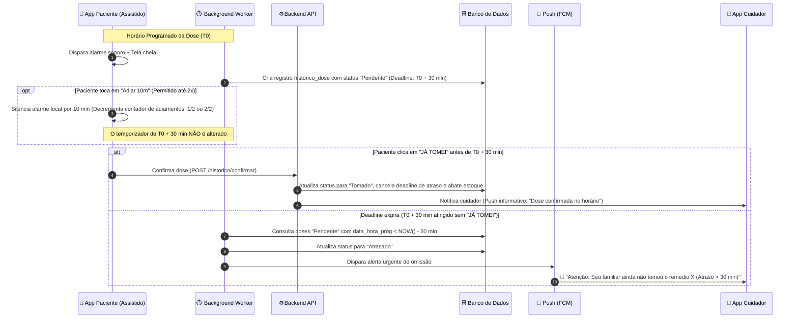

# 🏗️ 05. Arquitetura do Sistema e Stack Tecnológica

## 1. Visão Geral da Arquitetura

O sistema adota uma arquitetura orientada a serviços com clientes mobile multiplataforma, sincronização em tempo real e processamento em segundo plano (background jobs) para disparos de alertas e cálculos preditivos.

```mermaid
flowchart TB
    subgraph Clientes Mobile
        AppAssistido["📱 App Paciente Assistido (Modo Idoso)"]
        AppCuidador["📱 App Cuidador / Independente"]
    end

    subgraph API Gateway & Backend
        API["⚙️ Backend REST / GraphQL API"]
        AuthService["🔐 Auth & Perfil Service"]
        MedService["💊 Prescrição & Estoque Engine"]
        WorkerService["⏱️ Cron & Background Worker"]
    end

    subgraph Banco de Dados & Armazenamento
        DB[("🗄️ PostgreSQL / SQLite")]
        RedisCache[("⚡ Redis (Fila & Cache)")]
    end

    subgraph Serviços Externos
        FCM["🔔 Firebase Cloud Messaging (Push)"]
        TTS["🗣️ Text-to-Speech (Voz Local)"]
    end

    Clientes Mobile -->|HTTPS / WSS| API
    API --> AuthService
    API --> MedService
    API --> DB
    WorkerService --> RedisCache
    WorkerService --> DB
    WorkerService -->|Dispara Alerta Atraso / Compra| FCM
    FCM -->|Push Notification| AppCuidador
    AppAssistido --> TTS
```

---

## 2. Fluxo de Alarme, Trava de Adiar e Notificações Inteligentes




---

## 3. Sugestão de Stack Tecnológica

| Camada | Tecnologia Sugerida | Justificativa Técnica |
|---|---|---|
| **Mobile Frontend** | **Flutter** (Dart) ou **React Native** (Expo) | Excelente suporte multiplataforma (Android/iOS), alta performance gráfica para interfaces acessíveis e suporte nativo a alarmes em background e Text-to-Speech. |
| **Backend API** | **Node.js (NestJS/Express)** ou **Python (FastAPI)** | Alta velocidade de desenvolvimento, suporte nativo a operações assíncronas e tipagem forte. |
| **Banco de Dados** | **PostgreSQL** (com Supabase ou Prisma ORM) | Robustez relacional, integridade referencial ACID e suporte a consultas complexas de históricos. |
| **Mensageria & Push** | **Firebase Cloud Messaging (FCM)** | Padrão da indústria para entrega confiável de push notifications em Android e iOS. |
| **Background Jobs** | **BullMQ / Celery / pg_cron** | Agendamento preciso de checagens de atraso de doses e alertas diários de estoque. |

---

## 4. Estratégia de Funcionamento Offline e Sincronização (Offline-First)
- **Alarmes Locais:** Os alarmes das próximas 48 horas são pré-agendados e armazenados localmente no dispositivo do paciente usando SQLite / Local Notifications do sistema operacional, garantindo que o alarme toque pontualmente mesmo sem conectividade com a internet.
- **Fila Local de Eventos (Outbox Pattern):** Quando o paciente confirma a dose offline, o evento é gravado no banco de dados local com timestamp exato da ação e uma chave de idempotência (UUID único).
- **Garantia de Sincronização na Retomada de Rede:**
  - O app monitora os eventos de conectividade de rede (`Connectivity Listener`).
  - Ao detectar retorno da conexão (Wi-Fi ou 4G/5G), uma rotina de sincronização assíncrona envia a fila de eventos pendentes para a API.
  - O backend processa cada evento idempotentemente, atualiza o status no `historico_dose` com o horário real da confirmação, recalcula o saldo em `estoque` e cancela eventuais notificações de atraso pendentes.
