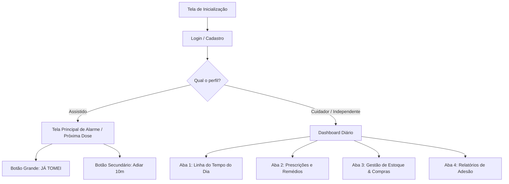

# 🎨 06. Diretrizes de UX/UI e Acessibilidade

## 1. Princípios de Design

O sistema possui duas propostas visuais distintas e complementares:

### 1.1. Modo Paciente Assistido ("Zero Fricção")
- **Foco:** Baixíssima carga cognitiva e máxima clareza.
- **Hierarquia:** Apenas 1 ação primária em tela quando o alarme dispara.
- **Contraste:** Conformidade estrita com WCAG AAA (mínimo 7:1 para elementos de ação).
- **Áudio:** Síntese de voz (TTS) para anunciar o nome do remédio e horário.
- **Tamanho dos Alvos de Toque:** Botões com altura mínima de 64dp/px para acomodar tremores e dificuldades motoras.

### 1.2. Modo Cuidador / Paciente Independente ("Gestão e Controle")
- **Foco:** Visão holística da saúde, linha do tempo diária e monitoramento de estoque.
- **Componentes:** Cards informativos, alertas de nível de criticidade (Amarelo = Estoque baixo, Vermelho = Dose atrasada, Verde = Tomado no prazo).

---

## 2. Mapa de Telas e Estrutura de Navegação



---

## 3. Guia de Cores e Estilo

| Cor / Token | Código Hex | Uso Principal |
|---|---|---|
| **Sucesso / Ação Primária** | `#16A34A` (Verde Esmeralda) | Botão "JÁ TOMEI", Doses Tomadas no Prazo |
| **Atenção / Estoque Baixo** | `#EAB308` (Amarelo Âmbar) | Alertas preventivos de compra, botão "Adiar" |
| **Alerta Crítico / Atraso** | `#DC2626` (Vermelho Rubi) | Dose Atrasada / Omissão, Estoque Esgotado |
| **Fundo Principal (Assistido)** | `#F8FAFC` (Neutro Claro) | Fundo limpo de alto contraste |
| **Texto de Alto Contraste** | `#0F172A` (Azul Escuro / Grafite) | Textos principais e títulos (mínimo 20pt para idosos) |
| **Primária (Cuidador)** | `#2563EB` (Azul Médico) | Navegação, barras e botões gerenciais |

---

## 4. Estrutura Visual da Tela de Alarme (Modo Idoso)

```text
+------------------------------------------+
|                                          |
|                ⏰ 08:00                  |
|                                          |
|        HORA DO SEU REMÉDIO:              |
|                                          |
|         [ 💊 FOTO DO REMÉDIO ]           |
|                                          |
|         LOSARTANA POTÁSSICA              |
|              50 mg                       |
|         Tomar: 1 comprimido              |
|                                          |
|  +------------------------------------+  |
|  |                                    |  |
|  |         ✅ JÁ TOMEI                |  |
|  |                                    |  |
|  +------------------------------------+  |
|                                          |
|  +------------------------------------+  |
|  |   ⏳ Adiar 10 min (1 de 2 disp.)   |  |
|  +------------------------------------+  |
|                                          |
+------------------------------------------+
```

---

## 5. Solução UX/UI para Múltiplos Remédios no Mesmo Horário

Quando o paciente toma **2 ou mais remédios no mesmo horário** (ex: 08:00), disparar múltiplos alarmes geraria confusão mental. O sistema resolve isso com duas abordagens integradas:

### 5.1. Conceito da "Bandeja Virtual" (Visão Geral Consolidada)
- Todos os remédios do horário são agrupados em um **único alarme sonoro**.
- A tela exibe uma **Bandeja de Medicamentos** com cartões visuais destacados (cor do comprimido, formato, foto real da embalagem e quantidade).
- O paciente tem o botão principal **"✅ TOMEI TODOS (3)"** ou pode desmarcar individualmente algum caso não tenha tomado.

### 5.2. Modo Passo a Passo Assistido por Voz (Opcional com 1 toque)
- O aplicativo narra e exibe **um remédio por vez** em tela cheia:
  1. *"Passo 1 de 3: Tome 1 comprimido branco de Losartana (Pressão)"* ➡️ Botão "Próximo".
  2. *"Passo 2 de 3: Tome 1 cápsula amarela de Vitamina D"* ➡️ Botão "Próximo".
  3. *"Passo 3 de 3: Tome 20 gotas de Dipirona"* ➡️ Botão "Concluir Doses".

### 5.3. Wireframe da "Bandeja Virtual" (Múltiplos Remédios com Trava de Adiar)

```text
+------------------------------------------+
| ⏰ 08:00 - HORA DOS SEUS REMÉDIOS (3)    |
| "Tome com água após o café da manhã"     |
+------------------------------------------+
|  +------------------------------------+  |
|  | [💊 Imagem]  LOSARTANA 50mg        |  |
|  | Tomar: 1 comprimido branco         |  |
|  +------------------------------------+  |
|  | [💊 Imagem]  METFORMINA 850mg      |  |
|  | Tomar: 1 comprimido grande         |  |
|  +------------------------------------+  |
|  | [🧴 Imagem]  VITAMINA D GOTAS      |  |
|  | Tomar: 5 gotas                     |  |
|  +------------------------------------+  |
|                                          |
|  +------------------------------------+  |
|  |                                    |  |
|  |      ✅ JÁ TOMEI TODOS (3)         |  |
|  |                                    |  |
|  +------------------------------------+  |
|                                          |
|  +------------------------------------+  |
|  |   🔊 Tomar um por um com voz       |  |
|  +------------------------------------+  |
|  +------------------------------------+  |
|  |   ⏳ Adiar 10 min (1 de 2 disp.)   |  |
|  +------------------------------------+  |
+------------------------------------------+
```

---

## 6. Comportamento Visual da Trava de Adiar (Snooze Lock)
- **1º Toque no Adiar:** O botão muda o rótulo para `⏳ Adiar 10 min (Última vez disponível)`.
- **2º Toque no Adiar:** Na reabertura do alarme após 10 minutos, o botão "Adiar" torna-se **desabilitado e acinzentado** com o texto `🚫 Limite de adiamentos atingido (Aviso ao cuidador em andamento)`.
- **Contagem Regressiva Imutável:** O backend e o worker mantêm o disparo de alerta ao cuidador estritamente programado para $T_0 + 30\text{ min}$, sendo cancelado exclusivamente mediante o toque em **"✅ JÁ TOMEI"**.
